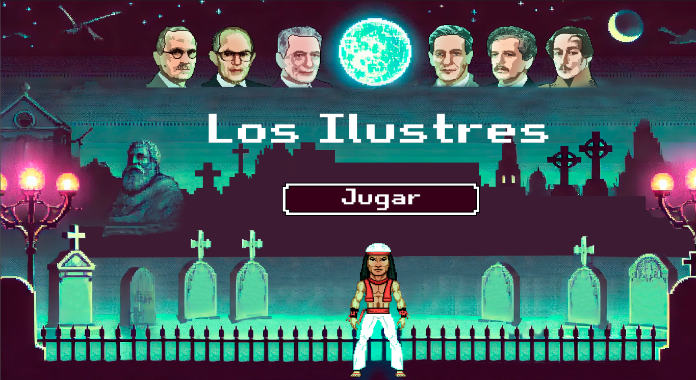
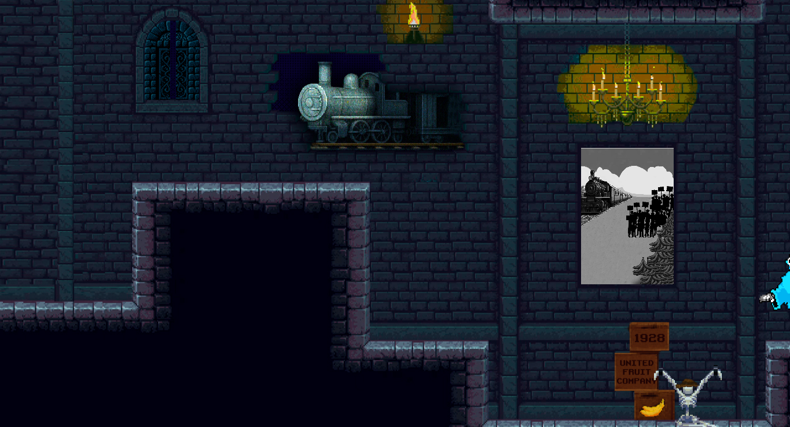
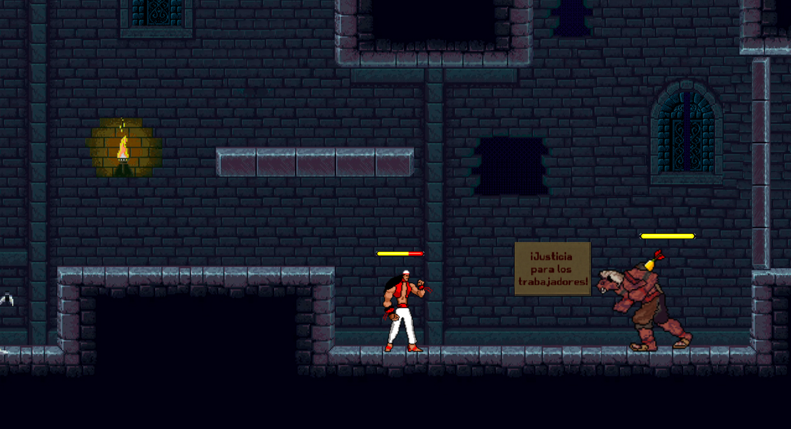
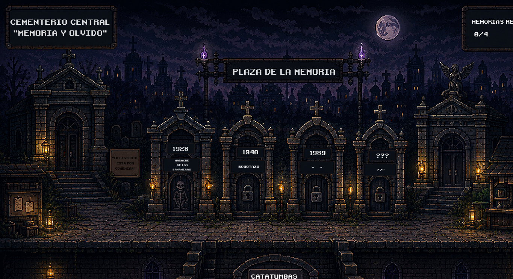

# LOS ILUSTRES

### Un videojuego que combina historia, creatividad y entretenimiento.

---

## Sobre el proyecto

**Los Ilustres** es un videojuego desarrollado en Godot Engine, inspirado en personajes ilustres de la historia de Colombia y creado como una experiencia interactiva que combina programación, diseño de escenarios y recursos audiovisuales.

Este proyecto nace de la exploración del desarrollo de videojuegos, integrando creatividad, narrativa y programación para construir una experiencia de juego propia.

## Capturas del videojuego
### Menú principal

### Gameplay

### Personajes y enemigos

### Escenarios

## Tecnologías utilizadas

- **Godot Engine:** motor de desarrollo del videojuego.
- **GDScript:** programación de mecánicas y funcionalidades.
- **Diseño 2D:** creación y organización de elementos visuales.
- **Recursos audiovisuales:** imágenes, sonidos y efectos.

## Características del proyecto

- Menú principal interactivo.
- Personajes y enemigos.
- Diseño de niveles y escenarios.
- Recursos gráficos y sonoros.
- Desarrollo de mecánicas de juego.

## ¿Cómo ejecutar el proyecto?

1. Descarga este repositorio.
2. Instala [Godot Engine](https://godotengine.org/).
3. Abre Godot.
4. Selecciona **Importar proyecto**.
5. Busca el archivo `project.godot`.
6. Abre el proyecto y ejecútalo.

## Estructura del proyecto

El proyecto contiene escenas, scripts, personajes, recursos gráficos, sonidos y elementos necesarios para el funcionamiento del videojuego.

## Desarrollo

Proyecto de creación y desarrollo de videojuegos realizado con Godot Engine.

**Estado:** Proyecto desarrollado.

⭐ Gracias por visitar Los Ilustres.

